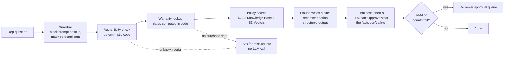
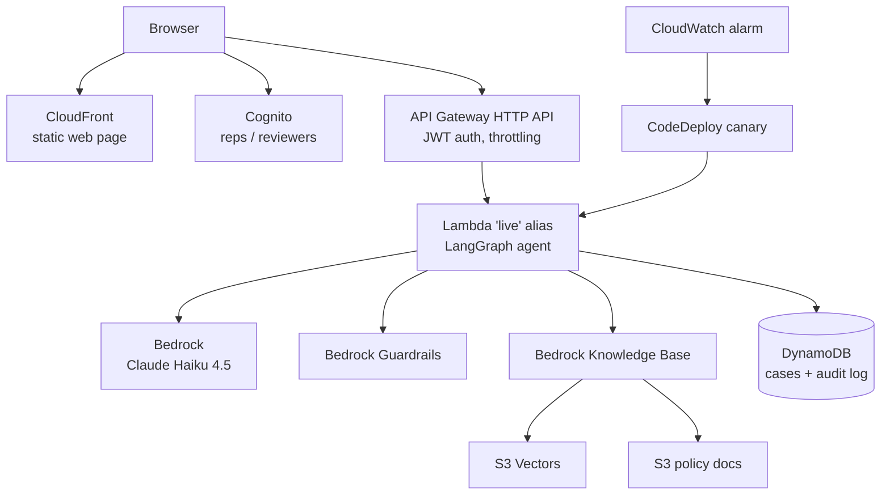
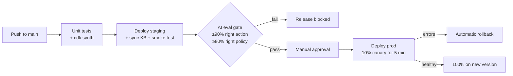

# Drive verification AI agent

An AI agent that helps support reps answer "Is this drive genuine?", "Is it under warranty?" and "Is it FIPS certified?" in seconds instead of 15–30 minutes, with cited policy sources, human approval for costly actions, and a full audit trail.

Built on AWS with Amazon Bedrock (Claude), LangGraph, Bedrock Knowledge Bases (RAG), Bedrock Guardrails, Lambda, API Gateway, DynamoDB, Cognito and CloudFront, deployed with AWS CDK and a GitHub Actions pipeline that includes an AI evaluation gate, manual approval and canary releases with automatic rollback.

> Portfolio project with fictional data. "Example Drives", its policies and all serial numbers are invented. It rebuilds the design of a system I worked on, without using any employer code or documents.

**Setup and deploy:** [docs/SETUP.md](docs/SETUP.md) (macOS, step by step).

## The core design choice: code decides, AI explains



- **Authenticity and warranty dates come from code**, never from the LLM.
- **The LLM appears in one step.** It must answer through a forced tool call, so the output is always structured: verdict, reasons, citations, action, customer message.
- **Code has the last word.** If the model suggests a replacement for a counterfeit or expired drive, `finalize` overrides it and records the override.
- **Humans approve costly actions.** RMA replacements and counterfeit flags wait for a reviewer, who can't approve their own case.
- **Everything is audited.** Each case records the model ID, prompt version, knowledge base, guardrail version, sources and token usage. The Lambda role can only insert into the audit table, never update or delete.

## AWS architecture



## Release pipeline



- **Where it runs:** GitHub Actions runs CI (tests and `cdk synth`) on every push. My AWS account blocks GitHub's OIDC connection, so the CD stages run from `scripts/release.sh` with the same gates. If OIDC is available, the workflow's deploy jobs switch on automatically once the `AWS_DEPLOY_ROLE_ARN` repo variable is set, with no stored AWS keys either way.
- **Staging and prod are separate stacks** with their own API, tables, knowledge base and logins.
- **The eval gate** runs 10 known cases (`eval/cases.jsonl`) against staging's real model, knowledge base and guardrail. A prompt or model change that lowers accuracy can't reach prod, even if all code tests pass.

## Demo deployment vs. full production design

This demo is serverless so that a week of running costs a few dollars. The full design changes these pieces:

| This demo | Full production | Why the demo differs |
|---|---|---|
| S3 Vectors (semantic search) | OpenSearch Serverless (hybrid keyword + vector) | OpenSearch has a monthly minimum of hundreds of dollars |
| DynamoDB | Aurora PostgreSQL | No hourly cost |
| Lambda | ECS Fargate or Bedrock AgentCore Runtime | Pay per request |
| No VPC | Private subnets + VPC endpoints (PrivateLink) | NAT gateways bill hourly |
| One account, two stacks | Separate AWS accounts per environment | AWS Organizations would end the Free plan |
| Insert-only DynamoDB audit table | S3 Object Lock (compliance mode) archive | Locked objects block teardown |

## Repo layout

```
app/                 Lambda code
  agent/graph.py     LangGraph workflow (the agent)
  agent/tools.py     authenticity, warranty, policy search
  agent/llm.py       the single LLM call, structured output
  agent/guardrails.py
  handler.py         API routes and role checks
  storage.py         DynamoDB cases + audit log
  data/drives.json   fictional drives
policies/            fictional policy documents (RAG source)
web/index.html       the web page
infra/               AWS CDK (staging, prod, GitHub OIDC)
eval/                evaluation cases + gate
tests/               unit tests (no AWS needed)
scripts/             build, ingest, smoke test, users, outputs
.github/workflows/   CI/CD pipeline
```

## Cost

About $15–40 for a week of building and demoing with Claude Haiku 4.5, mostly model usage. API throttling (5 requests/second) caps the damage if the URL leaks. Run `cdk destroy` when you're done ([docs/SETUP.md, step 9](docs/SETUP.md#9-tear-everything-down)).

## Talking points

- **Why a graph, not one big prompt?** Authenticity must be provable, policies cited and costly actions approved. Fixed steps with deterministic tools guarantee that; one prompt can't.
- **Why RAG, not fine-tuning?** Policies change, and every answer needs a citation.
- **How do you know it works?** Unit tests for the rules, an evaluation set for the AI, a gate in the pipeline, and a canary in prod.
- **Why Haiku?** It met the eval bar at a fraction of the cost of larger models. The model is a config setting (`infra/app.py`), so switching is a one-line change.
